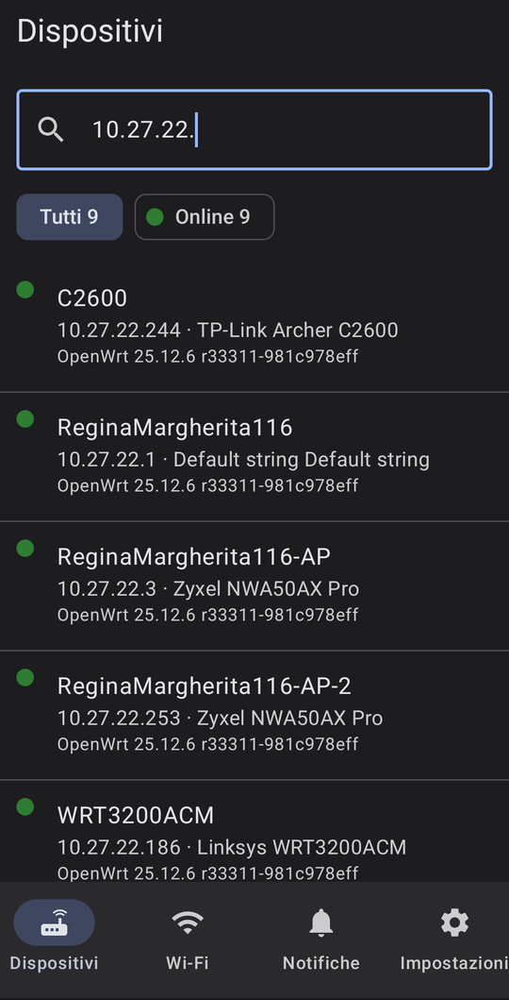
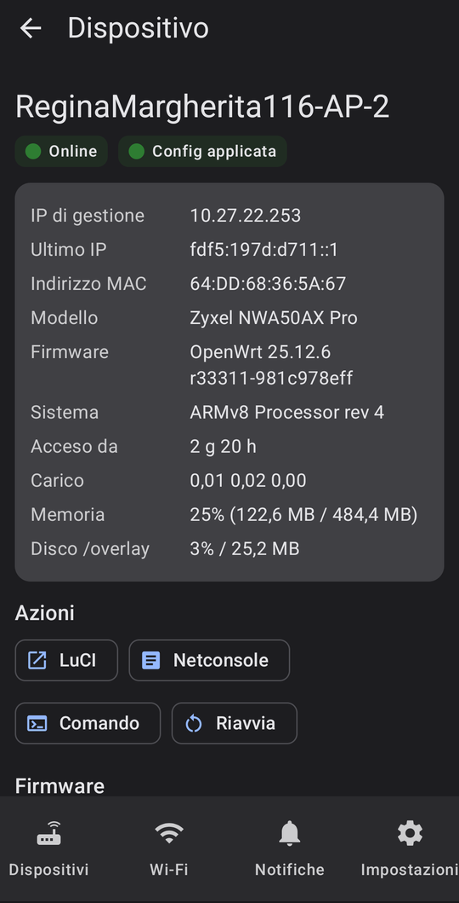
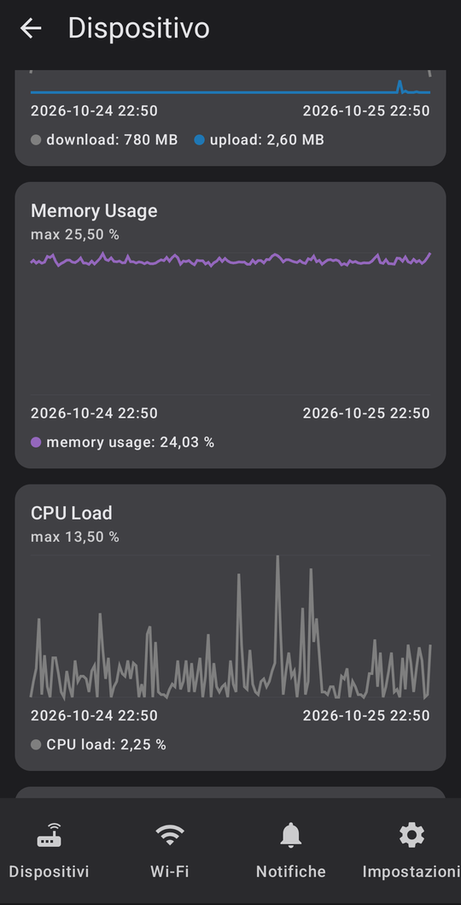
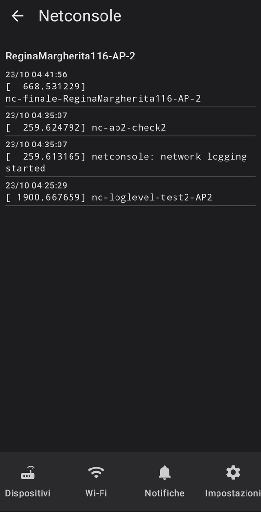

# openwisp-android

[🇬🇧 English](README.md) · 🇮🇹 Italiano

Un'app Android per gestire un server [OpenWISP](https://openwisp.org) dal
telefono, tramite le API REST di OpenWISP: dispositivi e loro stato, azioni
sui router, utenti e sessioni Wi-Fi, notifiche in background.

È un'app piccola e indipendente, nata per l'istanza OpenWISP di NINUX
Basilicata. Funziona con qualsiasi server OpenWISP; non è un progetto
ufficiale di OpenWISP.

| Dispositivi | Dispositivo | Grafici | Netconsole |
|---|---|---|---|
|  |  |  |  |

## 🧪 Diventa tester

L'app è giovane e ci piacerebbe provarla sul maggior numero possibile di
server OpenWISP e di telefoni. Arriverà anche su **Google Play**, e Google
chiede un test chiuso con dei tester registrati prima della pubblicazione.

- **Provala**: installa l'APK dalle
  [release](https://github.com/mikysal78/openwisp-android/releases) e usala con
  il tuo OpenWISP.
- **Registrati come tester** per la versione Google Play: scrivi a
  [app@ninux-nnxx.it](mailto:app@ninux-nnxx.it?subject=openwisp-android%20tester)
  indicando l'account Google che usi sul telefono. Il link al gruppo dei
  tester comparirà qui appena sarà aperto.
- **Segnala** problemi e idee nelle
  [issue](https://github.com/mikysal78/openwisp-android/issues) (i problemi di
  sicurezza in privato, vedi [SECURITY.md](SECURITY.md)).

## Funzioni

- **Dispositivi**: elenco con lo stato del monitoring (online, problema,
  critico), ricerca per nome, IP, MAC o modello, filtri per stato, prima i
  dispositivi con problemi.
- **Pagina del dispositivo**: IP di gestione e ultimo IP, modello, firmware,
  tempo di accensione, carico, memoria, disco, stato della configurazione;
  interfacce Wi-Fi con i loro client; i grafici del monitoring (ping, RTT,
  pacchetti persi, client Wi-Fi, traffico, CPU, memoria, disco) su 1, 3, 7 o
  30 giorni.
- **Azioni**, ognuna con una conferma: riavvio, comando di shell (con l'esito
  quando il comando finisce), aggiornamento del firmware con il firmware
  upgrader (build più recenti della stessa categoria con un'immagine dello
  stesso tipo), **LuCI** del router nel browser e log **netconsole**.
- **Wi-Fi** (openwisp-radius): utenti collegati, sessioni recenti con router,
  IP, MAC, durata e traffico; gli utenti del Wi-Fi si possono bloccare e
  sbloccare (staff e superuser non si bloccano dall'app).
- **Notifiche**: l'elenco delle notifiche di OpenWISP, da segnare come lette;
  un controllo ogni 15 minuti mostra quelle nuove come notifiche Android e
  toccandone una si apre il dispositivo.
- **Blocco dell'app** con impronta o blocco schermo, inglese e italiano, tema
  chiaro e scuro (colori Material You da Android 12).

## Requisiti

- Android 8.0 (API 26) o successivo.
- Un server OpenWISP in **HTTPS** con un certificato di una CA pubblica e un
  utente con accesso all'admin (staff). L'app può fare esattamente quello che
  questo utente può fare nell'admin di OpenWISP.
- L'app controlla quali moduli ha il server e mostra solo quello che c'è:
  senza openwisp-monitoring i dispositivi non hanno stato e grafici, senza
  openwisp-firmware-upgrader manca la sezione firmware, senza openwisp-radius
  manca la scheda Wi-Fi.
- Facoltativi, per i pulsanti LuCI e Netconsole:
  [openwisp-luci](https://github.com/mikysal78/openwisp-luci) 0.3.0 o
  successivo e [openwisp-netconsole](https://github.com/mikysal78/openwisp-netconsole)
  0.2.0 o successivo, con i loro `api_urls` inclusi sotto `api/v1/`. Senza, i
  pulsanti non compaiono.

## Installazione

Scarica l'APK dalle
[release](https://github.com/mikysal78/openwisp-android/releases) e aprilo sul
telefono (consenti l'installazione da quell'app quando Android lo chiede).

Tutte le release sono firmate con la stessa chiave; l'impronta SHA-256 del
certificato di firma è:

```
d2:88:0d:23:b5:75:8a:4b:60:57:bf:b4:d2:8f:0e:df:36:cd:81:0a:97:2d:5e:58:65:29:c6:b5:a3:16:4d:fe
```

Si controlla con `apksigner verify --print-certs openwisp-android-*.apk`, e il
file con `SHA256SUMS` nella release.

Con adb:

```bash
adb install openwisp-android-0.1.0.apk
```

## Uso

Inserisci il nome del server (per esempio `openwisp.example.com`), il nome
utente e la password. La password viene inviata una sola volta a
`/api/v1/users/token/` per ottenere il token delle API e non viene salvata.

## Sicurezza

- **Token**: OpenWISP dà un solo token delle API per utente. L'app lo salva
  cifrato con AES-GCM e una chiave del Keystore di Android non esportabile; i
  dati dell'app sono esclusi dai backup e dai trasferimenti tra telefoni.
- **Uscire** toglie il token dal telefono ma non lo revoca sul server, perché
  altri strumenti potrebbero usare lo stesso token dello stesso utente (per
  esempio una CI che carica i firmware). Per revocarlo, cancellalo nell'admin
  di OpenWISP (Auth Token).
- **Rete**: solo HTTPS, traffico in chiaro disattivato, solo le CA di sistema
  (i certificati aggiunti dall'utente non valgono), nessun redirect seguito, e
  il token va solo al server configurato (i link di paginazione verso altri
  host vengono ignorati).
- **Azioni**: riavvio, comandi, aggiornamenti e blocco degli utenti chiedono
  sempre una conferma. I comandi girano come root sul router: l'app mostra di
  nuovo il comando prima di eseguirlo.
- **Blocco dell'app**: attivo di default se il telefono ha un blocco schermo;
  lo richiede di nuovo dopo due minuti in background.
- **Intent**: l'unico componente esportato è l'activity di avvio; gli id dei
  dispositivi ricevuti dalle notifiche si accettano solo come UUID e i
  percorsi delle API non contengono mai segmenti `.` o `..`.
- **Notifiche** senza Google o altri servizi push: il telefono interroga il
  server OpenWISP, con il token, ogni 15 minuti.

Segnala le vulnerabilità in privato: vedi [SECURITY.md](SECURITY.md).

## Compilare l'APK

L'app si compila con Gradle (il wrapper è nel repository: scarica da solo la
versione giusta di Gradle e ne controlla lo SHA-256). Servono un **JDK 17 o
successivo** e gli strumenti da riga di comando dell'**Android SDK**; Android
Studio non è necessario.

1. **JDK** (Debian/Ubuntu):

   ```bash
   sudo apt install openjdk-21-jdk-headless unzip
   ```

2. **Android SDK**: scarica i *command line tools* da
   <https://developer.android.com/studio#command-line-tools-only>, poi:

   ```bash
   mkdir -p ~/Android/Sdk/cmdline-tools
   unzip commandlinetools-linux-*_latest.zip -d ~/Android/Sdk/cmdline-tools
   mv ~/Android/Sdk/cmdline-tools/cmdline-tools ~/Android/Sdk/cmdline-tools/latest
   export ANDROID_HOME=~/Android/Sdk
   yes | $ANDROID_HOME/cmdline-tools/latest/bin/sdkmanager --licenses
   $ANDROID_HOME/cmdline-tools/latest/bin/sdkmanager "platform-tools" "platforms;android-36" "build-tools;36.0.0"
   ```

3. **Codice sorgente**:

   ```bash
   git clone https://github.com/mikysal78/openwisp-android.git
   cd openwisp-android
   echo "sdk.dir=$HOME/Android/Sdk" > local.properties
   ```

4. **Test, lint e APK di debug** (firmato con la chiave di debug, va bene per
   provare l'app):

   ```bash
   ./gradlew testDebugUnitTest lintDebug assembleDebug
   # app/build/outputs/apk/debug/app-debug.apk
   ```

5. **APK di release**, firmato con una chiave tua. Crea la chiave una volta
   sola e **tienine una copia**: gli aggiornamenti di un'app installata devono
   essere firmati con la stessa chiave.

   ```bash
   keytool -genkeypair -keystore ~/openwisp-android.jks -storetype PKCS12 \
     -alias openwisp-android -keyalg RSA -keysize 4096 -validity 10000
   cat > keystore.properties <<EOT
   storeFile=$HOME/openwisp-android.jks
   storePassword=...
   keyAlias=openwisp-android
   keyPassword=...
   EOT
   chmod 600 keystore.properties
   ./gradlew assembleRelease
   # app/build/outputs/apk/release/app-release.apk
   ```

   `keystore.properties` è in `.gitignore`; in CI gli stessi valori possono
   arrivare dalle variabili d'ambiente `OW_KEYSTORE`, `OW_KEYSTORE_PASSWORD`,
   `OW_KEY_ALIAS` e `OW_KEY_PASSWORD`. Per Google Play si compila il bundle
   con `./gradlew bundleRelease` (`app/build/outputs/bundle/release/`).

6. **Installa** su un telefono con il debug USB attivo:

   ```bash
   $ANDROID_HOME/platform-tools/adb install -r app/build/outputs/apk/release/app-release.apk
   ```

   Un APK firmato con una chiave diversa non può sostituire quello
   installato: prima disinstalla l'app.

### Pubblicare una release

Le release le compila GitHub Actions
([`release.yml`](.github/workflows/release.yml)) al push di un tag `v*`:

1. aumenta `versionCode` e imposta `versionName` in `app/build.gradle.kts`;
2. aggiungi la sezione `## <versione>` a [CHANGELOG.md](CHANGELOG.md) (diventa
   la nota della release);
3. commit, poi `git tag -a v<versione> -m "openwisp-android <versione>"` e
   `git push origin v<versione>`.

Il workflow controlla che il tag corrisponda a `versionName`, esegue test e
lint, firma APK e AAB con la chiave dell'environment `release` (secret
`OW_KEYSTORE_BASE64`, `OW_KEYSTORE_PASSWORD`, `OW_KEY_ALIAS`,
`OW_KEY_PASSWORD`, usabili solo dai tag `v*`), verifica il certificato di
firma e pubblica i file con `SHA256SUMS` e un'attestazione di provenienza:

```bash
gh attestation verify openwisp-android-<versione>.apk -R mikysal78/openwisp-android
```

Il client delle API è in `app/src/main/java/.../data/Api.kt`, le schermate in
`ui/`, il controllo delle notifiche in background in
`work/NotificationWorker.kt`.

## Licenza

GPL-3.0-or-later, vedi [LICENSE](LICENSE). Il logo di OpenWISP usato come
icona dell'app viene da [openwisp-utils](https://github.com/openwisp/openwisp-utils)
(BSD-3-Clause); OpenWISP è un progetto della sua comunità, e questa app non ne
fa parte.
